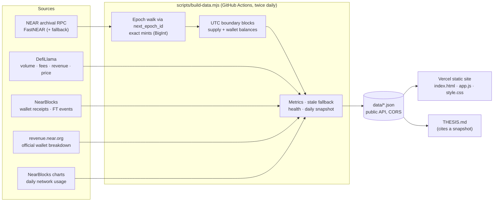

# NEAR Parity

[](https://github.com/Damianonyx/NEARparity/actions/workflows/ci.yml)
[](https://github.com/Damianonyx/NEARparity/actions/workflows/refresh.yml)
[](LICENSE)

**Are NEAR Intents buybacks keeping pace with new NEAR issuance?**

NEAR Parity is a live, on-chain research dashboard for the NEAR Hackathon (Investment Thesis track). It compares newly minted NEAR with NEAR Intents revenue, the evidence for buybacks, and the actual change in total supply, and it shows every calculation.

**Live site:** https://nearparity.vercel.app/ · **Thesis:** [THESIS.md](THESIS.md) · **Data API:** [docs/data-api.md](docs/data-api.md)

One distinction governs everything here: **buybacks do not automatically reduce total supply.** Purchased NEAR can stay in a treasury wallet. Matching issuance through purchases would not establish zero inflation or price appreciation.

## Quick start (do X → see Y)

Requirements: Node 22 (22.21 or newer if you are behind an HTTP proxy). **No `npm install`, no build step, no API keys, no dependencies.** The `npm` scripts are shortcuts for plain `node` commands.

| Do | See |
|---|---|
| `npm test` | 20 unit tests and 4 integration tests pass, offline. The integration tests run the real build end to end against a simulated NEAR chain and simulated APIs, and check every result exactly (BigInt), including stale fallbacks, a paused-then-resumed NearBlocks backfill, and RPC failover. |
| `npm start`, then open http://localhost:8080 | The dashboard, using the committed dataset in `data/`, served with the same security headers as production. |
| `npm run build` | Fresh data from the live sources: `data/latest.json`, `data/status.json`, and the day's snapshot. With the committed caches this takes about 15 seconds. Exit code 0 = all core sources refreshed, 2 = partial refresh (failed sources keep their last good values, marked stale). |
| `npm run test:ui` | Headless Chrome renders the page with the real data and with deliberately broken data, and checks that sections fail independently. |
| `npm run lint` · `npm run check:data` | Syntax and project rules for every JS file; the data contract for `data/latest.json`. |
| `npm run check:apis` · `npm run verify:claims` | Access check of every endpoint; re-fetch of the primary sources cited in THESIS.md. |
| `EXPLORER_JWT=… npm run check:explorer` (optional) | Key-gated check against the NEAR Intents Explorer API (1Click index): whether the withdrawing accounts' swaps are indexed (they are not) and which 1Click transactions name the buyback wallet. Saves `docs/explorer-check.json`. Get a key at partners.near-intents.org (key type: Explorer). |
| `npm run check:withdrawers` (optional, keyless) | Reads the event logs of a sample of the wallet's inflows from the archival RPC: which NEAR Intents accounts withdraw to the wallet, and whether the purchase appears in the same transaction (it does not). Saves `docs/withdrawer-sample.json`. |
| `NEAR_PARITY_SIMULATE_FAIL=chain,price npm run build` (in a copy of the repo) | The stale fallback in action: the named sources "fail", and their last good values are kept and marked stale with their date. |

## Architecture



- **Sources → build.** The build walks every epoch boundary since 2026-01-31 from block headers, finds the last block before each UTC boundary, reads total supply and the buyback wallet's balances there, and combines them with DefiLlama, NearBlocks and NEAR's own dashboard. Caches mean a refresh only fetches what is new.
- **Build → data.** Every metric is written in one shape (`value`, `unit`, `period_start`, `period_end`, `source`, `method`, `status`), with a public contract ([docs/data-api.md](docs/data-api.md)) enforced in CI.
- **Query behind every figure.** Each card and chart has a *Query* panel with the exact requests (curl, with the real block heights used in that build) and the formula, generated by the build into `latest.json` → `queries`. Each chart also carries one plain sentence on what it shows.
- **Hero simulation.** The balance scale is a live canvas simulation drawn from the data: tokens fall into the *issued* and *buybacks* pans at the measured rates, and a slider asks “what if Intents volume were k× today’s?”, holding capture rate, allocation and price fixed (coverage = measured proxy coverage × k), with the beam levelling at parity. It is labelled a conditional scenario, pauses off screen, and stays still for visitors who prefer reduced motion.
- **Data → site.** The page is static. It reads `data/latest.json` and `data/status.json`, renders each section independently, and shows a banner if the data is stale or malformed.

## Engineering

- **Tests.** Unit tests cover the formula, BigInt conversions, burn reconciliation, windowing, block search, epoch checks, wallet accounting, and source parsing. Integration tests run the build end to end against a simulated network (`scripts/fixtures/mock-network.mjs`). The UI test runs headless Chrome against real and degraded data. All run in CI on every push and pull request (`.github/workflows/ci.yml`).
- **Resilience.** Each source is isolated, and a failed or incomplete source keeps its last good values, marked stale; it never becomes zero. The archival RPC fails over to a second endpoint. NearBlocks paging resumes where it stopped. The page renders each section independently.
- **Monitoring.** `data/status.json` records every source's outcome. After two partial refreshes in a row, or any crash, the refresh workflow opens a `data-refresh` issue, and closes it on recovery. The site shows a banner when the last successful refresh is more than 36 hours old.
- **Security.** The site is static with no third-party scripts, and is served with a strict Content-Security-Policy, `nosniff`, `frame-ancestors 'none'`, and related headers (`vercel.json`). Only the files the page needs are deployed (`.vercelignore`). There are no keys or secrets anywhere.
- **Reproducibility.** Every figure is pinned to block heights and hashes, and one immutable snapshot is kept per UTC day.

## Repository map

```
index.html, style.css, app.js     dashboard (no framework; app.js imports the tested formula from scripts/lib/calc.mjs)
scripts/build-data.mjs            orchestrates one build: fetch → compute → write data/
scripts/lib/calc.mjs              pure calculations (parity formula, BigInt yoctoNEAR, burn reconciliation, windows)
scripts/lib/near.mjs              NEAR RPC with failover: epoch walk, timestamp → block search, wallet balances (incl. staking)
scripts/lib/sources.mjs           DefiLlama, prices, NearBlocks (receipts + FT events), revenue dashboard
scripts/lib/wallet.mjs            wallet accounting: staking pools, internal transfers, creation date
scripts/lib/io.mjs                file store, source status, HTTP helpers
scripts/test.mjs                  unit tests        scripts/test-integration.mjs   end-to-end tests (simulated network)
scripts/smoke-ui.mjs              headless-Chrome UI test    scripts/lint.mjs · check-data.mjs   lint and data contract
scripts/serve.mjs                 local server (mirrors production headers)
scripts/check-apis.mjs            endpoint access check      scripts/verify-claims.mjs     re-checks THESIS sources
config/buyback-wallet.json        the buyback wallet, its official citation, related revenue wallets
data/                             committed dataset and public API (docs/data-api.md)
.github/workflows/                ci.yml, refresh.yml, api-check.yml, verify-claims.yml
```

## Data sources

| Source | Used for |
|---|---|
| NEAR mainnet archival RPC (FastNEAR) `https://archival-rpc.mainnet.fastnear.com` | Epoch boundaries, total supply, burns, protocol config, wallet balances |
| DefiLlama `api.llama.fi/summary/dexs/near-intents` | NEAR Intents swap volume |
| DefiLlama `api.llama.fi/summary/fees/near-intents?dataType=dailyFees / dailyRevenue / dailyHoldersRevenue` | Gross fees, net revenue, and revenue labelled as buyback money |
| DefiLlama coins `coins.llama.fi/chart/coingecko:near` and `/prices/current/coingecko:near` | Daily and current NEAR/USD price. Documented fallback: CoinGecko `api/v3/coins/near/market_chart` |
| NEAR revenue dashboard (official) `https://revenue.near.org/` | Official listing of the buyback wallet; NEAR attributed to each revenue wallet (cross-check) |
| NearBlocks API (keyless) `api.nearblocks.io/v1/account/{account}/txns` and `/ft-txns` | The buyback wallet's receipts and FT events |
| NEAR Intents Explorer API `explorer.near-intents.org/api/v0/transactions` (key-gated, optional; not used by the daily build) | One-off check of the 1Click index for the buyback operator and wallet (`docs/explorer-check.json`) |
| BigQuery public NEAR dataset `bigquery-public-data.crypto_near_mainnet_us` (free sandbox; one-off, not used by the daily build) | On-chain buyback trace: `native_withdraw` intents to the wallet, the swaps and transfers behind them (`queries/bigquery/`, `config/bigquery-trace.json`) |
| NearBlocks network charts (keyless) `api.nearblocks.io/v1/charts` | Daily active accounts, transactions, new accounts and active contracts (network usage) |

## NEAR integrations used

- **JSON-RPC methods:** `block` (headers: `total_supply`, `timestamp_nanosec`, `epoch_id`, `next_epoch_id`, `prev_hash`; chunk `balance_burnt`), `EXPERIMENTAL_protocol_config` (`max_inflation_rate`, `protocol_version`), `query` → `view_account`, and `query` → `call_function` on `wrap.near` (`ft_balance_of`) and `intents.near` (`mt_balance_of` for `nep141:wrap.near`).
- **Archival reads by block hash**, so every figure is pinned to a specific block (heights and hashes are in `data/boundaries.json` and `data/epochs.json`).
- **Epoch walk by header:** on the archival node, `validators` returns `UNKNOWN_EPOCH` for older epochs. Instead, a block's `next_epoch_id` is the hash of the previous epoch's last block, so the build walks back epoch by epoch from headers alone.
- **The buyback wallet** `buybacks.multisignature.near`, a multisig listed on NEAR's revenue dashboard, plus the two other listed revenue wallets, `fefundsadmin.sputnik-dao.near` and `1csfundsadmin.sputnik-dao.near`.

- **NEAR Intents event logs** (`dip4` `native_withdraw` and `token_diff`, `nep245` `mt_transfer`/`mt_mint`), read from the archival RPC (`EXPERIMENTAL_tx_status`) and from the BigQuery public NEAR dataset.

No wallet connection or smart contract is needed.

## Calculation definitions

All default comparisons use **one window: the 30 most recent complete UTC days** (start inclusive, end exclusive). Every metric is stored with `value`, `unit`, `period_start`, `period_end`, `source`, `method` and `status`, where status is `measured`, `estimate`, `proxy` or `unavailable`. An unavailable metric has `value: null` and a `reason`; it is never 0 and never a guess. yoctoNEAR amounts are BigInt and become decimals only for display.

- **Issuance (measured).** NEAR mints at each epoch boundary. For each boundary: `mint = total_supply(first block) − total_supply(previous block) + Σ balance_burnt of chunks included in the first block`. This is exact, because for any block `total_supply = previous supply + minted − burnt`, which the build verified to the yoctoNEAR. Period issuance is the sum over boundaries whose first block falls in the period. Boundaries since 2026-01-31 are cached in `data/epochs.json`.
- **Sanity checks.** Within each epoch, supply may only fall. Each mint should sit at or just below `supply × max_inflation_rate × epoch duration ÷ 31,556,952 s`; a ratio below 0.95 or above 1.001 is flagged. The maximum inflation rate is a cap and is never shown as measured issuance.
- **Supply at a UTC instant** is the `total_supply` of the last block before that instant. The build finds it with an interpolated binary search over heights, skipping missing heights.
- **Actual supply change (measured)** = supply(end) − supply(start).
- **Burns (measured, derived)** = issuance − supply change over the same period. Burns are never added to the supply change again, and treasury purchases are never counted as burns.
- **Intents economics (measured, as reported by DefiLlama)**: daily values summed over the 30 days. If any day is missing, the total is unavailable. Capture rate = net revenue ÷ volume, in basis points.
- **Network usage (measured, as reported by NearBlocks):** 30-day means of NearBlocks' daily `active_accounts`, `txns` and `active_contracts`, and the 30-day sum of `new_accounts`, each compared with the previous 30 days. Weekly values are indexed to the week of 2026-02-01 = 100 next to Intents volume (DefiLlama, per day). The build also reports the largest one-day fall in transactions and a descriptive correlation of week-over-week changes. Definitions of the fields are NearBlocks' own.
- **Buyback proxy (proxy)** = Σ over days of (DefiLlama holders revenue in USD ÷ that day's NEAR price). DefiLlama labels captured revenue from 2026-02-23 as buyback money. That is a label, not a record of purchases.
- **Wallet net accumulation (measured)** = change in NEAR held by the buyback wallet (native liquid + locked, wNEAR, and wNEAR inside `intents.near`) between the window's boundary blocks, **minus** transfers from NEAR's other listed revenue wallets, which only move revenue that was already captured. It is net accumulation, not proof of purchases.
- **Buyback coverage** = buyback NEAR ÷ newly issued NEAR over the same period. *Verified* coverage uses the BigQuery on-chain trace: NEAR bought in swaps by the accounts that fund the wallet ÷ issuance of the same window (a measured lower bound, updated daily from BigQuery; see Limitations). The proxy and wallet versions are labelled `proxy`.
- **Parity simulator (conditional scenario):** `Required daily volume (USD) = daily issuance (NEAR) × NEAR price (USD) ÷ (net revenue capture rate × buyback allocation)`. Rates are decimal fractions (bps ÷ 10,000, % ÷ 100). If either rate is zero, the result is "No finite volume achieves parity under these assumptions." The result is not a prediction and not a supply-neutrality threshold.

## Data files

Full field reference: [docs/data-api.md](docs/data-api.md).


- `data/latest.json`: every metric, the weekly series since 2026-02-01, simulator defaults, the wallet reconciliation and the source list.
- `data/status.json`: per source, ok or failed, HTTP code, error, fetched_at, last_ok_at.
- `data/bigquery-daily.json` (when the daily BigQuery trace is enabled): per UTC day, NEAR withdrawn to the buyback wallet and NEAR bought in swaps by the accounts that fund it (yoctoNEAR strings), plus those accounts and the first day each was seen.
- `data/snapshots/<UTC timestamp>.json`: an immutable copy of the first successful build of each UTC day, so the history is auditable.
- `data/epochs.json`, `data/boundaries.json`, `data/wallet-transfers.json`: caches, so refreshes only fetch new epochs, blocks and transfers.

## Limitations

- **Verified purchases are a lower bound for one window.** A one-off BigQuery trace ([`queries/bigquery/`](queries/bigquery/), results in [`docs/bigquery-results.json`](docs/bigquery-results.json)) verifies 73,168 NEAR bought in 7,979 swaps by the accounts that fund the wallet, 15 Oct – 13 Nov 2026: 2.7% of issuance. Another 191,434 NEAR reached them by transfer from a high-volume market-maker-like account, so its payment is not visible and it is not counted. Since 14 Nov 2026 the refresh workflow extends it daily (`config/bigquery.json`, Workload Identity Federation, no stored keys): each run queries only the new UTC day (about 1.2 GB, with a hard byte cap) and the figures follow the dashboard window. Its first run reproduced the console results exactly. If BigQuery is unavailable, the one-off snapshot is shown with its own window. Earlier keyless checks: the wallet receives NEAR from `intents.near` every 30–90 minutes. Each inflow is a `native_withdraw` intent signed by an account inside NEAR Intents (seen in the `dip4` event logs). A sample of 120 inflows found 47 different withdrawing accounts, two of them behind most withdrawals, and none carried its purchase in the same transaction ([`docs/withdrawer-sample.json`](docs/withdrawer-sample.json), `npm run check:withdrawers`). The NEAR is bought earlier, in separate transactions that have no keyless public index. Keyless sources cannot link them, which is why BigQuery was needed. The wallet is listed on NEAR's official revenue dashboard, which confirms the account, not the purchases.
- **The Explorer API cannot verify the buybacks.** The first-party 1Click index has no transactions by the withdrawing accounts checked (including the two behind most withdrawals), and its rate limit (about one request per 30 s in practice) makes it impractical for 30-day volume totals, so DefiLlama remains the volume source. It did reveal four third-party transfers into the wallet (3,988.7 NEAR, June–September), which slightly overstate the wallet measure.
- **Wallet scope.** Holdings include native NEAR, wNEAR, wNEAR inside `intents.near`, and NEAR delegated to any staking pool the wallet has called (none so far). Liquid-staking tokens are not counted.
- **Network usage comes from NearBlocks** (keyless), so the daily build needs no Google account. BigQuery (free sandbox) is used only for the one-off buyback trace. NearBlocks' field definitions are not formally documented; a step change on 2026-04-02 (transactions −72% in a day, active accounts flat) is shown but its cause is not verified.
- **The proxy depends on a label.** DefiLlama's holders revenue equals its net revenue from 2026-02-23 onward. Converting it to NEAR at each day's 00:00 UTC price ignores execution prices and timing.
- **DefiLlama figures are third-party aggregates**, reported as published and labelled with `reported_by`. DefiLlama revises history: between two builds on 14 Nov 2026, gross fees for the same 30 days moved from $5.83 M to $6.27 M. Daily values can also lag by a day; if so, the previous value is kept and marked stale rather than understated.
- **Burns are derived**, not read from a burn event log. They include all protocol burns (gas and fees) and nothing else.
- **The wallet reconciliation is only partly explained.** On-chain holdings differ from the dashboard's all-time figure, mostly because of an internal transfer from another NEAR revenue wallet and one outflow. About 26 NEAR remains unexplained (THESIS.md).
- **Price source:** DefiLlama coins (coingecko:near), daily samples matched to the nearest UTC midnight within ±10 minutes.
- **Rate limits and providers:** FastNEAR and keyless NearBlocks rate-limit bursts. The build retries with backoff, fails over to a second archival RPC, saves progress, and resumes on the next run. The CoinGecko price fallback covers at most 365 days; older days would show as unavailable.

## Disclosure

The code in this repository was written with AI coding assistants, **Claude Code** (Anthropic) and **Codex** (OpenAI), under the author's direction. Data and claims were checked against the sources listed above, and every number in THESIS.md can be traced to `data/latest.json` or a cited source.

## License

[MIT](LICENSE) © 2026 Damianonyx
